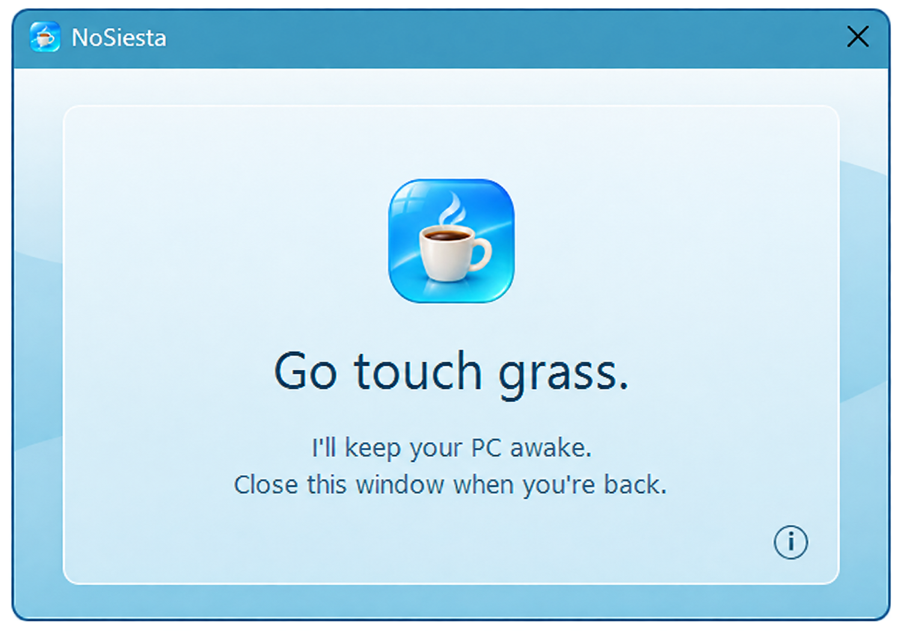

# NoSiesta ☕

A tiny, portable Windows app with a **Frutiger Aero** look. Open it to keep your PC and screen awake. Close it to let Windows sleep normally.

[Download NoSiesta v1.0.0](https://github.com/kapsaloco/NoSiesta/releases/tag/v1.0.0)

  

Made as a tribute to the original **Don't Sleep**, which I used as a teenager when the internet was slow and I needed to keep my PC awake while downloads finished.

To build, install Visual Studio Build Tools with **Desktop development with C++** and the Windows SDK, then run `build.cmd`. Open `build/NoSiesta.exe`.

Free and open-source under the [MIT License](LICENSE).
